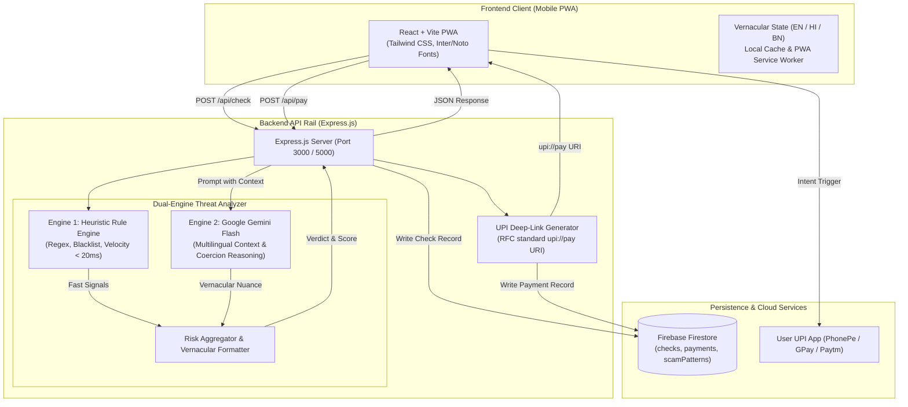

# System Architecture & Integrations (ARCHITECTURE.md)

> **Tech Stack**: React + Vite PWA → Express.js API → Dual-Engine Threat Shield (Deterministic Rule Engine + Google Gemini AI) → Firebase Firestore.

---

## 1. High-Level System Architecture



---

## 2. Component Specifications

### 2.1. Frontend: React + Vite PWA
- **Framework**: React 18+ with Vite for instant HMR and minimal bundle footprint (<100KB gzipped).
- **Styling**: Tailwind CSS configured with the bright, minimalist design tokens specified in `DESIGN.md`.
- **PWA Capabilities**: Web App Manifest (`manifest.json`) and service worker for offline shell loading and fast caching.
- **State Management**: Native React hooks + Context for Language switching (`en`, `hi`, `bn`).

### 2.2. Backend: Express.js API Rail
- **Middleware**: `cors`, `express.json()`, request rate-limiting, and error handling.
- **Fail-Safe Fallback**: If external AI or network calls exceed a 1000ms deadline, the local Heuristic Rule Engine serves the verdict instantly so user payments are never blocked by network latency.

---

## 3. Integrations

### 3.1. Google Gemini API Integration
- **Model**: `gemini-1.5-flash` or `gemini-2.0-flash` (low latency, high reasoning fidelity).
- **Purpose**: Understands conversational deception in Hindi, Bengali, Hinglish, and English; identifies subtle urgency tricks (e.g., *"electricity cut off tonight at 9:30 PM"* or *"lottery processing fee"*).
- **Request Format**:
  ```javascript
  const prompt = `Analyze this message for UPI/banking scam indicators in India.
  User Language: ${language} (en / hi / bn).
  Message: "${rawMessage}"
  
  Respond in valid JSON only:
  {
    "riskScore": 0-100,
    "verdict": "SAFE" | "CAUTION" | "SCAM",
    "signals": ["list of detected suspicious patterns"],
    "explanation": "Clear explanation in ${language} addressed to a first-time user",
    "extractedUpi": "upi_id_if_found_or_null"
  }`;
  ```

### 3.2. UPI Deep-Link Protocol Integration
- **Protocol**: Standard NPCI UPI URI Specification (`upi://pay`).
- **URI Structure**:
  ```
  upi://pay?pa={payeeVpa}&pn={payeeName}&am={amount}&cu=INR&tn={transactionNote}
  ```
- **Execution**: On mobile devices, triggering this URL directly opens the user's default installed UPI app (Google Pay, PhonePe, Paytm, BHIM) with pre-filled, verified parameters.

### 3.3. Firebase Firestore Integration
- **SDK**: `firebase-admin` (Node.js backend) or Firebase JS SDK v10+.
- **Database**: Cloud Firestore in `us-central1` or `asia-south1` (Mumbai for lowest Indian latency).
- **Collections**:
  - `checks`: Logs every scam scan with score, verdict, and timestamp.
  - `payments`: Logs verified pay intents.
  - `scamPatterns`: Curated and community-reported active scam definitions.

---

## 4. Latency & Resilience Budget

| Step | Component | Target Latency | Fail-Safe Behavior |
| :--- | :--- | :--- | :--- |
| 1 | Rule Engine Heuristic Scan | < 15ms | In-memory regex & blacklist lookup |
| 2 | Gemini API Context Analysis | 400 – 800ms | If timeout > 1200ms, use Rule Engine score |
| 3 | Firestore Log Write | Background async | Fire-and-forget; doesn't block response |
| **Total** | **API Response to User** | **< 600ms** | Guaranteed sub-second feedback |
