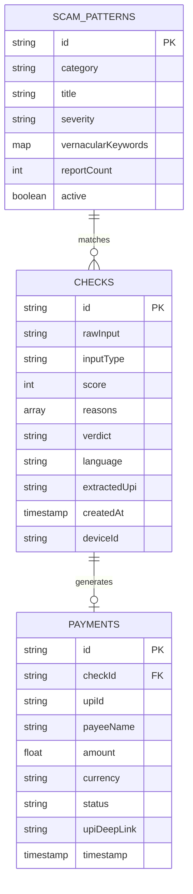

# Database Schema & Data Models (DATABASE.md)

> **Database**: Google Cloud Firestore (NoSQL Document Store)  
> Designed for high-speed writes, document-level security, and seamless vernacular querying.

---

## 1. Firestore Collections Overview



---

## 2. Detailed Collection Schemas

### 2.1. `checks` Collection
Stores every scam check performed by users, enabling auditing, trend detection, and personal history.

```json
{
  "id": "chk_89f72b14",
  "rawInput": "Dear customer, your electricity power will be disconnected tonight at 9.30 pm from electricity office. Please immediately call officer at 9876543210 or pay bill to powerbill@okaxis",
  "inputType": "TEXT_MESSAGE", // "TEXT_MESSAGE" | "UPI_ID" | "QR_CODE"
  "score": 92,                  // 0 to 100
  "verdict": "SCAM",            // "SAFE" | "CAUTION" | "SCAM"
  "reasons": [
    "Unsolicited threat of immediate utility disconnection",
    "Personal VPA (powerbill@okaxis) used instead of official state discom portal",
    "Pressure tactic (tonight 9:30 PM deadline)"
  ],
  "extractedUpi": "powerbill@okaxis",
  "language": "hi",             // "en" | "hi" | "bn"
  "vernacularExplanation": "यह एक बिजली बिल धोखाधड़ी है। सरकारी बिजली विभाग कभी भी व्यक्तिगत UPI आईडी पर पैसे नहीं मांगते।",
  "deviceId": "anon_dev_93fa88",
  "createdAt": "2026-11-14T08:30:00.000Z"
}
```

---

### 2.2. `payments` Collection
Logs verified pay intents and deep-link generation events.

```json
{
  "id": "pay_5a129d81",
  "checkId": "chk_10c84e92",
  "upiId": "ramu.tea@upi",
  "payeeName": "Ramu Tea Stall",
  "amount": 350.00,
  "currency": "INR",
  "status": "INITIATED",        // "INITIATED" | "COMPLETED" | "CANCELLED" | "BLOCKED"
  "upiDeepLink": "upi://pay?pa=ramu.tea@upi&pn=Ramu%20Tea%20Stall&am=350.00&cu=INR&tn=Tea%20bill%20TrustLayer",
  "timestamp": "2026-11-14T08:35:12.000Z"
}
```

---

### 2.3. `scamPatterns` Collection
Repository of active Indian scam vectors used by the Heuristic Rule Engine and Gemini context injector.

```json
{
  "id": "pattern_electricity_discom",
  "category": "UTILITY_DISCONNECTION",
  "title": "State Electricity Disconnection Threat",
  "severity": "CRITICAL",
  "indicators": [
    "disconnect", "power cut", "light cut", "bijli", "9.30 pm", "officer number"
  ],
  "vernacularKeywords": {
    "hi": ["बिजली", "लाइन कटेगी", "तुरंत कॉल करें", "बिल बकाया"],
    "bn": ["বিদ্যুৎ সংযোগ বিচ্ছিন্ন", "বিল বাকি", "লাইন কাটা যাবে", "অফিসার কল"]
  },
  "knownFraudVpas": [
    "powerbill@okaxis",
    "bijlibill.update@ybl"
  ],
  "reportCount": 1420,
  "active": true
}
```

---

## 3. Firestore Security Rules

```javascript
rules_version = '2';
service cloud.firestore {
  match /databases/{database}/documents {
    
    // Checks collection: Anyone can create a check; users can read their own
    match /checks/{checkId} {
      allow create: if request.resource.data.score is int;
      allow read: if resource.data.deviceId == request.auth.uid || request.auth == null;
    }
    
    // Payments collection: Logged on create
    match /payments/{paymentId} {
      allow create: if request.resource.data.amount > 0;
      allow read: if true;
    }
    
    // Scam patterns: Public read-only
    match /scamPatterns/{patternId} {
      allow read: if true;
      allow write: if false; // Admin managed only
    }
  }
}
```
