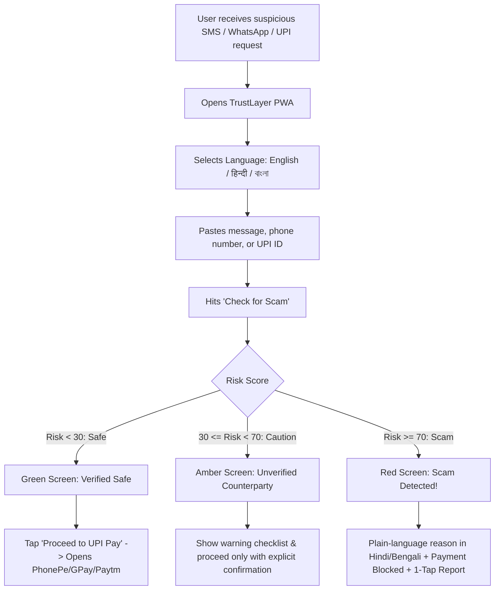

# Product Requirements Document (PRD) — TrustLayer

> **Project Name**: TrustLayer  
> **Track**: Financial Technology & Payments  
> **Tagline**: The vernacular scam guard and safe payment companion for first-time UPI users.

---

## 1. Problem Statement
UPI processes over 14 billion monthly transactions across India, bringing hundreds of millions of first-time digital users, senior citizens, and rural adopters into the formal banking system. 

However, this population is aggressively targeted by social engineering scams:
- **Fake KYC Expiry Alerts:** Threatening bank account freeze unless an immediate fee is sent.
- **Lottery & Prize Scams:** Coercive messages instructing users to "pay processing fee to receive ₹25,00,000".
- **Reverse UPI Phishing / Fake Collect Requests:** Asking users to enter their UPI PIN to *receive* money.
- **Mule Account Exploitation:** Routing stolen funds through fast-cycled, unverified VPAs.

Because UPI settlements are immediate and irrevocable, post-transaction bank complaints have near-zero recovery rates. First-time users lack technical literacy and English fluency, making traditional banking disclosures ineffective.

---

## 2. Target Users
1. **First-Time Digital Adopters & Tier-2/3 Users:** New to smartphones and digital payments, vulnerable to intimidation tactics.
2. **Senior Citizens:** Frequently targeted by fake pension, electricity bill, and KYC vishing calls.
3. **Vernacular Speakers (Hindi & Bengali):** Users who cannot understand English security prompts and dismiss standard warnings.
4. **Informal Nano-Merchants & Street Vendors:** Small business owners receiving customer payments who need to verify suspicious collect requests.

---

## 3. Core Features

### 3.1. Instant Scam Check (`/api/check`)
- Users paste a suspicious SMS, WhatsApp message, payment link, or UPI ID.
- Dual-layer inspection: Fast heuristic rule engine + Google Gemini AI context analysis.
- Output: Clear **Safe / Caution / Scam** verdict with a 0–100 Risk Score.
- Plain-talk explanation highlighting *why* the message is unsafe (e.g., "Legitimate banks never ask for fees via personal UPI IDs").

### 3.2. Safe UPI Pay (`/api/pay`)
- If the recipient passes verification, TrustLayer generates a verified `upi://pay` deep link.
- If high risk is detected, payment is blocked with an unavoidable warning screen.
- If moderate risk is detected, a 15-minute cool-down warning and double-confirmation prompt are shown.

### 3.3. Hindi & Bengali Vernacular Toggle
- One-click instant language switch: **English**, **हिन्दी (Hindi)**, and **বাংলা (Bengali)**.
- All risk explanations, warnings, and button prompts rendered natively in the selected language.

### 3.4. Community Trust Dashboard (`/api/stats`, `/api/history`)
- Real-time counter of community scam reports and money protected.
- Feed of recently identified scam patterns (e.g., "Electricity bill disconnection scam active in West Bengal").
- Personal user check history stored in Firestore.

---

## 4. End-to-End User Journey

---

## 5. Out of Scope (What NOT to Build)
To preserve hackathon velocity and avoid unnecessary complexity, the following are **strictly out of scope**:
- Direct banking core switch / NPCI host settlement implementation (we use standard simulated client-side `upi://pay` URI intents).
- Full user registration/passwords (use Firebase Anonymous Authentication or simple device IDs).
- Native iOS/Android app store builds (a mobile-responsive PWA is the target).
- Physical hardware biometric scanning or device sensors.
- Crypto/Web3 payment integrations.
