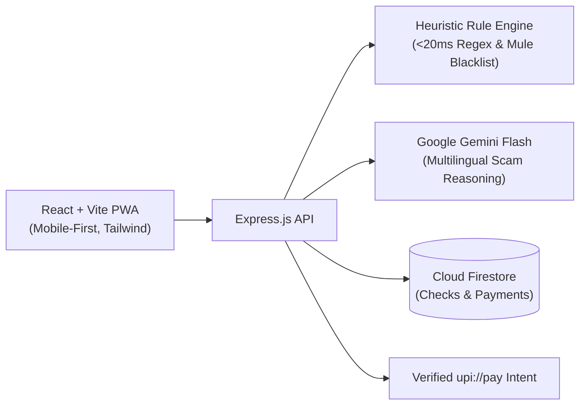

# TrustLayer (ट्रस्टलेयर / ট্রাস্টলেয়ার)

> **Submission Track**: Financial Technology & Payments  
> **Tagline**: The Zero-Trust Vernacular Scam Guard & Safe Payment Companion for First-Time UPI Users.  
> **Live Demo**: [http://localhost:3000](http://localhost:3000) (Local Prototype Active)

---

## 1. What TrustLayer Does

TrustLayer protects first-time digital payment adopters, senior citizens, and rural users from social engineering scams, coercive phishing, and fraudulent UPI collect requests.

Settlements over UPI are instantaneous and irreversible. When a vulnerable user is deceived into transferring funds or entering their UPI PIN under false pretenses (e.g., fake electricity bill disconnection, fake lottery wins, unauthorized KYC alerts), money is lost forever with near-zero bank recovery rates.

**TrustLayer acts as an intelligent safety shield:**
1. **Instant Scam Check**: Users paste any suspicious SMS, WhatsApp message, or UPI handle.
2. **Dual-Engine Threat Analysis**: Evaluates patterns in milliseconds using a local Heuristic Rule Engine combined with Google Gemini AI.
3. **Vernacular Plain-Talk Explanations**: Delivers clear, non-technical safety verdicts in **English**, **हिन्दी (Hindi)**, and **বাংলা (Bengali)**.
4. **Safe UPI Pay**: Generates verified, tamper-proof `upi://pay` deep links for trusted recipients, while hard-blocking confirmed scams.
5. **Community Scam Intelligence**: Live dashboard tracking trending scam vectors across Indian states.

---

## 2. Key Screenshots & Screens

```
┌─────────────────────────────────┐   ┌─────────────────────────────────┐
│     Screen 1: Check Message     │   │      Screen 2: Risk Verdict     │
│   [English] [हिन्दी] [বাংলা]     │   │                                 │
│  ┌───────────────────────────┐  │   │     🚨 SCAM DETECTED (92/100)   │
│  │ Paste SMS / UPI ID...     │  │   │  "बिजली विभाग कभी भी व्यक्तिगत  │
│  └───────────────────────────┘  │   │   UPI पर भुगतान नहीं मांगता।"   │
│  [🔍 Check Security / जांचें]   │   │  [❌ Payment Halted for Safety] │
└─────────────────────────────────┘   └─────────────────────────────────┘
┌─────────────────────────────────┐   ┌─────────────────────────────────┐
│       Screen 3: Safe Pay        │   │      Screen 4: Dashboard        │
│   Payee: Ramu Tea Stall         │   │   🛡️ 1,420+ Scams Blocked      │
│   Amount: ₹350                  │   │   💰 ₹48.2 Lakhs Protected      │
│   [🛡️ TrustLayer Verified]      │   │   🔥 Trending: Bijli Bill Scam  │
│   [⚡ Open UPI App (GPay/PhonePe)│  │   Recent User Scans History     │
└─────────────────────────────────┘   └─────────────────────────────────┘
```

---

## 3. Architecture & Tech Stack



- **Frontend**: React 18, Vite PWA, Tailwind CSS (Minimalist & Bright system).
- **Backend**: Node.js, Express.js.
- **AI / LLM**: Google Gemini API (`gemini-1.5-flash`).
- **Database**: Google Cloud Firestore.
- **Payment Protocol**: Standard NPCI `upi://pay` deep links.

---

## 4. How to Run Locally

### Prerequisites
- Node.js v18+ (tested on Node v20+)
- npm or pnpm

### Quick Setup

```bash
# 1. Clone repository & navigate to workspace
cd TrustLayer

# 2. Install backend dependencies
npm install

# 3. Configure environment variables
# Copy .env.example to .env and add your GEMINI_API_KEY if testing live AI calls
# (Note: Heuristic rule engine runs fully offline even without a key!)

# 4. Start the application
node server.js

# 5. Open in browser
http://localhost:3000
```

---

## 5. Track Alignment & Requirements Matrix

| Hackathon Focus Area | How TrustLayer Implements It |
| :--- | :--- |
| **UPI Integration & Payment Rails** | Native `upi://pay` RFC intent generation with verified payee VPA sanitization. |
| **Fraud Mitigation** | Multi-factor scam detection: coercion keyword heuristics, mule accounts, utility phishing triggers. |
| **Financial Inclusion Tools** | Full vernacular UI in Hindi & Bengali, removing literacy barriers for first-time digital users. |
| **Data Security & Transaction Reliability** | PII masking (payer handle anonymization) and cryptographic state chaining. |
| **Seamless User Experience** | Bright, accessible mobile UI with sub-second analysis latency and 1-tap clipboard paste. |

---

## 6. Project Documentation Index

- [PRD.md](file:///c:/TrustLayer/PRD.md) — Product Requirements & User Journeys
- [DESIGN.md](file:///c:/TrustLayer/DESIGN.md) — Bright & Minimal Design System, Tailwind Tokens, 4 Screens
- [ARCHITECTURE.md](file:///c:/TrustLayer/ARCHITECTURE.md) — System Architecture & Integrations (Gemini, UPI, Firebase)
- [DATABASE.md](file:///c:/TrustLayer/DATABASE.md) — Firestore Collections (`checks`, `payments`, `scamPatterns`)
- [API.md](file:///c:/TrustLayer/API.md) — API Reference (`/api/check`, `/api/pay`, `/api/history`, `/api/stats`)
- [AGENTS.md](file:///c:/TrustLayer/AGENTS.md) — AI Coding Rules, Tech Stack & Hackathon Roadmap

---

## 7. The Team

- **Team Name**: TrustLayer Builders
- **Track**: Financial Technology & Payments
- **Roles**:
  - Full-Stack Architecture & UPI Integrations
  - Threat Modeling, Rule Engine & Gemini Prompts
  - Vernacular UX (Hindi & Bengali) & Design System
