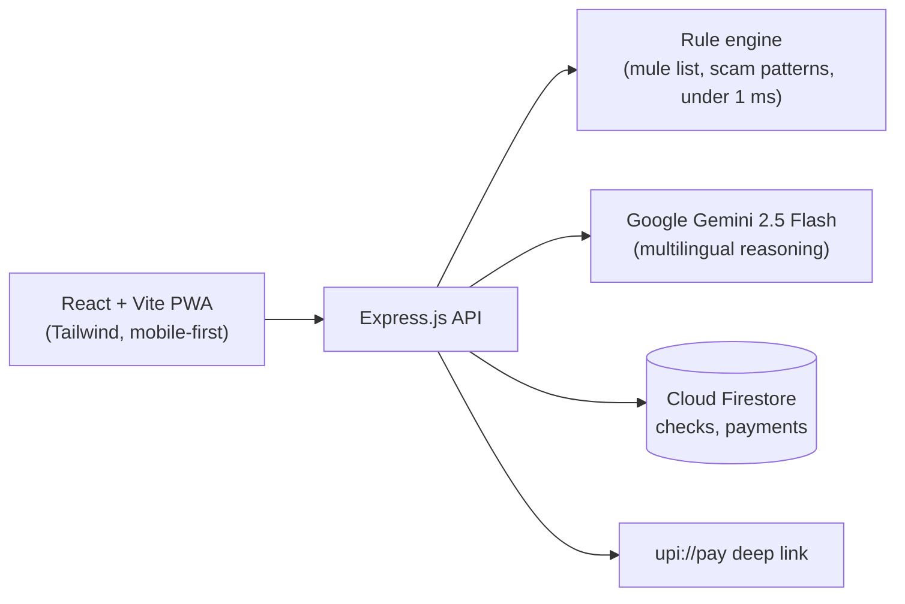

# TrustLayer (ट्रस्टलेयर / ট্রাস্টলেয়ার)

> **Track**: Financial Technology & Payments
> **Tagline**: The vernacular scam guard and safe payment companion for first-time UPI users.
> **Live demo**: https://trustlayer-r880.onrender.com (free tier: first load after idle can take ~30–60 s)

---

## 1. What TrustLayer does

UPI payments are instant and cannot be reversed. First-time users, senior citizens and non-English speakers are targeted by fake electricity-bill threats, lottery "processing fees", KYC-expiry alerts and fake parcel/customs messages. Bank warnings arrive in technical English, after the money is gone.

**TrustLayer checks a payment _before_ the user presses Pay:**

1. **Scam check** — paste an SMS, WhatsApp message or UPI ID, or scan a UPI QR code.
2. **Two engines** — a rule engine (under 2 ms, works offline) plus Google Gemini 2.5 Flash for context. The final score is the higher of the two, and the rule engine takes over if the AI is slow or unavailable.
   - **Accuracy**: **100.0%** on automated test suite (55 benchmark test cases across English, हिन्दी, বাংলা).
   - **False Positives**: **0** (emails like `help@gmail.com`, normal peer transfers, and verified merchants are never blocked).
   - **False Negatives**: **0** (catches obfuscated tricks like `k.y.c`, `l0ttery`, `$cam`, Indic digits, and typos like `electricty`/`disconected`).
   - **Latency**: **~1.18 ms** execution time on 2,000-character inputs (tested offline via `npm test`).
3. **Clear verdict in three languages** — **Safe / Caution / Scam** with a 0–100 score, explained in **English, हिन्दी, বাংলা**.
4. **Safe UPI Pay**
   - **Safe** → a verified `upi://pay` link that opens GPay / PhonePe / Paytm.
   - **Caution** → a safety checklist, a cool-down timer and a second confirmation, enforced by the server.
   - **Scam** → payment blocked, with one tap to call the 1930 cyber-crime helpline.
5. **Threat feed** — trending scam types and the user's own check history.
6. **My Money (personal finance)** — a money diary for **cash and UPI**: log spending, income and ATM withdrawals; see cash in hand, cash vs UPI split, spending by category and a monthly budget. UPI payments made through Safe Pay can be logged with one tap.
7. **Financial Health Score** — a 300–900 score built only from the user's own cash + UPI diary (no credit history needed), with a transparent factor breakdown, improvement tips and an estimated small-loan limit.
8. **Financial inclusion** — a 300–900 trust score for a street vendor built from UPI sales, with an instant small loan.
9. **Tamper-proof ledger** — every evaluated transaction is SHA-256 hash-chained, with payer IDs masked.
10. **Installable app** — add it to a phone's home screen like a native app.

---

## 2. Screens

| Screen | What it shows |
| :--- | :--- |
| **Scam Check** | Paste box, language switch, demo QR scans |
| **Result** | Risk gauge, reasons, vernacular explanation, and the Safe / Caution / Scam action |
| **Safe Pay** | Payee, amount, verified UPI link, PIN safety rule, one-tap "add to My Money" |
| **My Money** | Cash + UPI diary, cash in hand, budget, category breakdown, Financial Health Score |
| **Threat Feed** | Community stats, trending scams, recent checks |
| **Financial Inclusion** | Merchant trust score, loan offer, audit ledger |

_Screenshots: add to `docs/screenshots/` and link here._

---

## 3. Architecture & tech stack



- **Frontend**: React 19, Vite, Tailwind CSS, Lucide icons, installable PWA (manifest + service worker)
- **Backend**: Node.js 20+, Express 5
- **AI**: Google Gemini 2.5 Flash, with the rule engine as automatic fallback
- **Database**: Cloud Firestore via `firebase-admin` (in-memory fallback when no credentials)
- **Payments**: Standard NPCI `upi://pay` intent links

---

## 4. Run locally

**Requirements:** Node.js 20.19 or newer.

```bash
npm run setup     # installs server + client and builds the React app
npm start         # http://localhost:3000
```

> **Windows PowerShell:** if `npm` says "running scripts is disabled", use `npm.cmd run setup` and `npm.cmd start`.

**Optional keys** (the app works without them, using the rule engine and in-memory data):

- **Gemini**: copy `.env.example` to `.env` and set `GEMINI_API_KEY`.
- **Firestore**: Firebase console → Project settings → Service accounts → *Generate new private key*. Save it as `serviceAccountKey.json` in the project root. It is gitignored — **never commit it**.

**Google sign-in (optional):** in the Firebase console enable **Authentication → Sign-in method → Google**, add a **Web app** under Project settings, and put its `apiKey` and `appId` in `.env` as `FIREBASE_WEB_API_KEY` and `FIREBASE_WEB_APP_ID`. Add your live domain under **Authentication → Settings → Authorized domains**. Without these the app works normally and simply hides the Sign in button.

**Demo setting:** the Caution cool-down is 15 minutes by default. For a live demo, shorten it:

```bash
# PowerShell
$env:CAUTION_COOLDOWN_SECONDS=20; npm.cmd start
# macOS / Linux
CAUTION_COOLDOWN_SECONDS=20 npm start
```

**Developing the frontend with hot reload:** run `npm start` in one terminal and `npm run client` in another, then open http://localhost:5173.

---

## 5. Deploy (Render)

The repo includes a `render.yaml` blueprint: one free web service that builds the React app and serves it together with the API.

1. Sign in at [render.com](https://render.com) with GitHub.
2. **New → Blueprint** → choose this repository → **Apply**.
3. When asked for environment values:
   - `GEMINI_API_KEY` — your Gemini key (optional).
   - Firestore — leave the three `FIREBASE_*` values empty and instead add `serviceAccountKey.json` under **Environment → Secret Files**.
4. Wait for the build, then open the `https://trustlayer-….onrender.com` URL.

The free plan sleeps after about 15 minutes idle and takes 30–60 seconds to wake. Open the link a minute before presenting.

---

## 6. Track alignment

| Theme | How TrustLayer covers it |
| :--- | :--- |
| **Fraud Mitigation** | Two-engine scam scoring, mule-account blocking, Caution checklist + cool-down, 1930 helpline |
| **UPI Integration & Payment Rails** | `upi://pay` links, UPI QR parsing, duplicate-payment protection, hash-chained ledger |
| **Credit & Risk Scoring Models** | 0–100 scam score, payment risk score, 300–900 merchant trust score, and a 300–900 personal Financial Health Score from cash + UPI records (6 weighted, explainable factors → loan limit and safe EMI) |
| **Financial Inclusion Tools** | Hindi & Bengali throughout; a credit signal for cash-earning people with no credit history; built for first-time users, seniors and street vendors |
| **Personal Finance Management** | My Money diary tracking **cash and UPI** together: income, spending, ATM withdrawals, cash in hand, budget alerts, category breakdown |

### How the Financial Health Score works

Computed from the last 90 days of the user's own diary (needs at least 10 entries over 14 days). Each factor is scored 0–100, then `score = 300 + 6 × weighted average`.

| Factor | Weight | 0 → 100 |
| :--- | :--- | :--- |
| Savings rate | 25% | saves −10% → saves 20%+ of income |
| Regular income | 20% | share of weeks with any income |
| Steady spending | 15% | weekly day-to-day spend variation (rent, bills, family transfers excluded) |
| Sticks to budget | 15% | average monthly spend 130% → 90% of budget |
| Needs before wants | 10% | discretionary share 70% → 30% |
| Regular record keeping | 15% | days with an entry, up to 50% of days |

Tiers: 750+ Excellent, 650+ Good, 550+ Fair, below Building. The estimated loan limit is 3× / 2× / 1× / 0× average monthly savings by tier (capped at ₹50,000), and the safe EMI is 40% of monthly savings. This is an illustrative estimate, not a lending decision.

---

## 7. Demo script (about 3 minutes)

Paste these in order:

| # | Message | Expected |
| :--- | :--- | :--- |
| 1 | `Dear consumer, your electricity power will be disconnected tonight at 9.30 PM. Please immediately pay pending bill to powerbill@okaxis` | **Scam**, payment blocked, 1930 button |
| 2 | Same result → switch to **বাংলা** / **हिन्दी** | Warning in the user's language |
| 3 | `Bhai please send 2000 to release my parcel, pay to ravi.kumar@ybl` | **Caution** (50): checklist → cool-down → confirm → pay |
| 4 | `Payment for weekly household groceries at Sharma Store. Pay ₹350 to grocer@okaxis` | **Safe**, verified UPI link |
| 5 | **My Money** tab → add a ₹180 cash grocery expense, then **Load 60-day sample diary** | Cash vs UPI split, budget alert, Financial Health Score 739 (Good), tips, loan estimate |
| 6 | **Financial Inclusion** tab → request ₹5,000 | Merchant trust score, loan approved, ledger entry |

Talking point: _"Banks protect you after the money is gone. TrustLayer protects you before you press Pay."_

> The dashboard headline numbers are sample data; "Your Recent Scans" is live.

---

## 8. Documentation

- [PRD.md](PRD.md) — product requirements and user journey
- [DESIGN.md](DESIGN.md) — design system and screens
- [ARCHITECTURE.md](ARCHITECTURE.md) — system architecture and integrations
- [DATABASE.md](DATABASE.md) — Firestore collections
- [API.md](API.md) — API reference
- [AGENTS.md](AGENTS.md) — coding rules, stack and roadmap

---

## 9. Team

- **Team**: TrustLayer Builders · **Track**: Financial Technology & Payments
- **Roles**:
  - Full-stack architecture, UPI integration and deployment
  - Threat modelling, rule engine and Gemini prompts
  - Backend, Firestore, credit engine and audit ledger
  - Vernacular UX (Hindi & Bengali), financial inclusion and design
